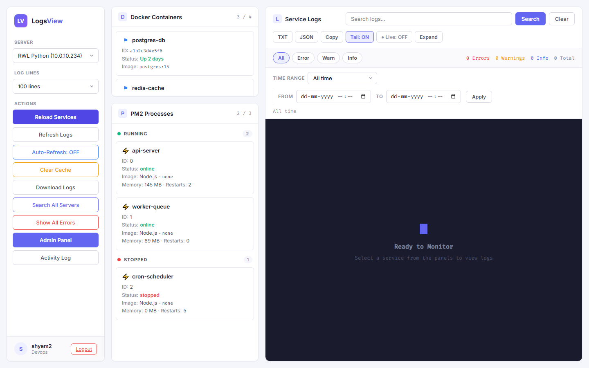
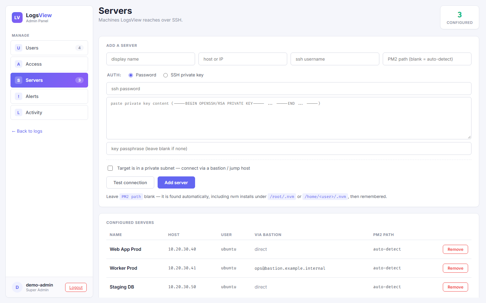
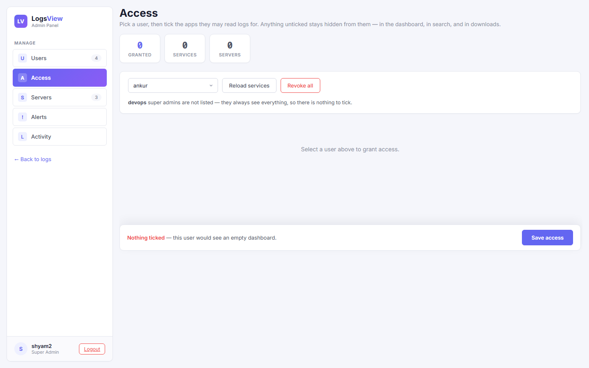
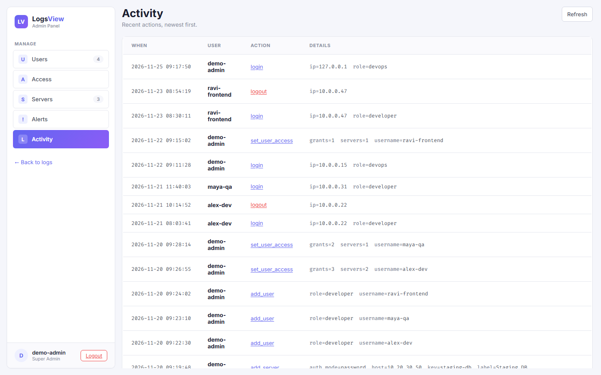

# LogsView

> Copyright (c) 2026 Shyam Sutahr. All rights reserved. This is portfolio code — view-only. See [LICENSE](LICENSE).

A self-hosted web UI to view **PM2** and **Docker** logs across many remote servers over **SSH** — with role-based access, encrypted credential storage, and an audit trail. No agent is installed on the target servers; LogsView reaches each host over an SSH connection (optionally through a bastion/jump host) and runs `pm2 logs` / `docker logs` on demand.

Built as a lightweight internal tool to speed up incident response when you have servers scattered behind bastions and you don't want to `ssh` into each one just to tail a log.

---

## Why this exists

When something breaks in production, the first 5 minutes are spent SSH-hopping: open a terminal, pick a bastion, pick a server, remember the PM2 process name, tail the log. LogsView collapses that into: pick server from a dropdown, pick process, see logs — with date-range filtering and a one-click restart.

The second problem it solves is **who can see what**. Developers often need log access to debug their own service without being handed root on every box. LogsView lets a DevOps admin grant a developer access to just `api-server` on `prod-1`, nothing else.

---

## Features

**Logs & services**
- SSH into any registered server and list PM2 processes + Docker containers
- Tail logs with line-count and date-range filters
- One-click PM2 restart / stop (devops role only)
- Works through a bastion / jump host (SSH tunneling via `direct-tcpip`)
- Password or SSH private key auth (PEM / OpenSSH / RSA / Ed25519 / ECDSA)

**Access control**
- Two roles: `devops` (full access) and `developer` (scoped)
- Developers get per-server, per-service grants (e.g. `dev1` → `prod-1` → `pm2: ['api-server']`)
- `*` wildcard grants all services of that type on a server
- The last devops user cannot be deleted or demoted (prevents lockout)

**Security**
- Server passwords and SSH private keys stored encrypted at rest (Fernet / AES-128)
- The Fernet key is kept outside the repo in `~/.secrets/logsview.key` (chmod 600 where supported)
- User database (`users.dat`) is Fernet-encrypted; passwords themselves are `bcrypt` hashes
- Login brute-force protection: 5 failed attempts per IP → 5 minute block
- Session cookie is HttpOnly + SameSite=Lax; 8-hour sliding lifetime
- SSH connection test endpoint before you save a server
- Admin-only server add / remove with warning that re-adding wipes grants (prevents silent access regrant)

**Observability**
- Every state-changing action is appended to `activity.log` (JSONL): who, when, what, from where
- Activity tab in the admin UI displays the last 500 entries, newest first

**Operator experience**
- Mock mode for demos / local dev — no real SSH needed, returns realistic fake PM2 and Docker data
- Auto-detects PM2 even when installed under `nvm` (`/root/.nvm/...`, `/home/*/.nvm/...`)
- Single-file config via `.env` + `servers.yaml`; no database server

---

## Screenshots

Drop PNGs into `images/` with these filenames and they will render here:

| View | File |
|---|---|
| Login | `images/login.png` |
| Dashboard (server picker + services) | `images/dashboard.png` |
| Log view with date filter | `images/logs.png` |
| Admin – Servers | `images/admin-servers.png` |
| Admin – Users | `images/admin-users.png` |
| Admin – Access grants | `images/admin-access.png` |
| Admin – Activity log | `images/admin-activity.png` |

```markdown




```

---

## Tech stack

| Layer | Choice | Why |
|---|---|---|
| Web framework | **Flask 3** | Minimal, well-understood, fits a single-file app |
| WSGI server | **Waitress** | Production-grade, pure-Python, no C deps on Windows |
| SSH client | **Paramiko** | Pure Python SSH with transparent bastion support |
| Password hashing | **bcrypt** | Industry default, slow by design |
| At-rest encryption | **cryptography / Fernet** | Authenticated symmetric encryption (AES-128-CBC + HMAC) |
| Config | **PyYAML + python-dotenv** | Human-readable `servers.yaml`, env-based secrets |
| Frontend | Vanilla HTML/CSS/JS | No build step, no npm, no bundler |

---

## Architecture

```
Browser
  │
  │  HTTPS-ready (served via waitress; put behind nginx for TLS)
  ▼
Flask app (app.py)
  ├─ pages blueprint   /login, /, /admin
  ├─ api blueprint     /api/servers, /api/servers/<k>/services, /api/servers/<k>/logs
  └─ admin blueprint   /api/admin/servers, /api/admin/users, /api/admin/access, /api/admin/activity
         │
         ▼
  SSHClient (paramiko)  ──► optional bastion ──► target host
         │
         ├─ PM2Adapter    pm2 jlist / pm2 logs / pm2 restart
         └─ DockerAdapter docker ps / docker logs --since --until --timestamps
```

Storage layout on disk:

```
servers.yaml              # server list; passwords/keys stored as Fernet tokens
users.dat                 # entire JSON file is Fernet-encrypted; contains bcrypt hashes
activity.log              # JSONL audit trail, append-only
~/.secrets/logsview.key   # Fernet key, generated on first run, never in git
```

---

## Getting started

### Prerequisites
- Python 3.11+
- Target servers reachable over SSH (for real mode) — or none (for mock mode)
- Optional: PM2 and/or Docker installed on target hosts

### Install

```bash
git clone https://github.com/<you>/logsview.git
cd logsview
python -m venv .venv
.\.venv\Scripts\activate         # Windows
# source .venv/bin/activate      # Linux/macOS
pip install -r requirements.txt
```

### Configure

```bash
cp .env.example .env
# edit .env — at minimum set FLASK_SECRET_KEY to a long random string
```

Generate a random secret:

```bash
python -c "import secrets; print(secrets.token_hex(32))"
```

`.env` keys:

| Key | Default | Purpose |
|---|---|---|
| `FLASK_SECRET_KEY` | *(required in prod)* | Signs session cookies |
| `LOGSVIEW_MOCK_MODE` | `true` | `true` = fake data, no SSH. `false` = real SSH |
| `LOGSVIEW_HOST` | `127.0.0.1` | `0.0.0.0` to expose on LAN (waitress is used automatically) |
| `LOGSVIEW_PORT` | `5050` | Port |

### Run

```bash
python app.py
```

Open http://localhost:5050. The **first user to visit `/login` becomes the devops admin** (first-run bootstrap) — pick a strong password; this is the only account that can register additional users.

---

## Usage walkthrough

**1. Add a server** (Admin → Servers)
- Fill label, host, username, pick Password or SSH private key
- Click **Test connection** — this opens an SSH session and runs a probe that detects PM2 (including nvm installs) and Docker
- If the probe succeeds, click **Add server**; credentials are Fernet-encrypted before being written to `servers.yaml`
- For private subnets, tick **Target is in a private subnet** to add bastion/jump-host credentials

**2. Add a developer** (Admin → Users)
- Create a user with role `developer` — they can log in but see nothing yet

**3. Grant access** (Admin → Access)
- Pick the user, pick a server, tick the PM2 processes or Docker containers they are allowed to view
- Use `*` to grant all current and future services of that type on that server

**4. View logs** (main dashboard)
- Pick a server, pick a PM2 process or Docker container, set a date range or line count, view/stream logs
- DevOps users also see **Restart** and **Stop** buttons; developers do not

**5. Audit** (Admin → Activity)
- Every login, logout, add_server, delete_server, add_user, delete_user, role change, grant change — all captured

---

## Security notes

- **Credentials never leave the server.** The browser never receives server passwords or SSH keys; they are decrypted in-process only for the duration of an SSH session.
- **The Fernet key file must be backed up.** If you lose `~/.secrets/logsview.key`, `servers.yaml` and `users.dat` become unreadable. If you want to rotate it, decrypt first, then re-encrypt with the new key.
- **Put TLS in front.** Waitress serves plain HTTP. For production, terminate TLS at nginx/Caddy and proxy to `127.0.0.1:5050`.
- **Restart loses sessions.** Changing `FLASK_SECRET_KEY` invalidates all cookies; keep the same value across restarts (store it in `.env`).
- **The dashboard is read-mostly.** The only mutating SSH commands sent to target servers are `pm2 restart <id>` and `pm2 stop <id>`, and only when the UI button is pressed by a devops user. Everything else is read-only (`pm2 jlist`, `pm2 logs`, `docker ps`, `docker logs`).

---

## Project structure

```
logsview/
├── app.py                      # Flask app factory + entrypoint
├── config.py                   # Settings, servers.yaml read/write with secret stripping
├── requirements.txt
├── .env.example
├── servers.yaml.example
├── logsview/
│   ├── auth.py                 # @login_required, rate limiting, session helpers
│   ├── crypto.py               # Fernet key management
│   ├── user_store.py           # Encrypted users.dat: bcrypt + Fernet, role & grants
│   ├── ssh_client.py           # Paramiko wrapper with bastion support
│   ├── pm2_adapter.py          # pm2 jlist/logs/restart, nvm auto-detect, date filter
│   ├── docker_adapter.py       # docker ps/logs with --since/--until
│   ├── activity.py             # JSONL audit log
│   └── routes/
│       ├── pages.py            # /login, /, /admin HTML routes
│       ├── api.py              # /api/servers/<k>/services, /logs, grant filtering
│       └── admin.py            # /api/admin/* (devops only): servers, users, access, activity
├── templates/                  # Jinja2: login.html, dashboard.html, admin.html, base.html
├── static/                     # Vanilla JS + CSS
└── images/                     # README screenshots (see Screenshots section)
```

---

## Mock mode

Set `LOGSVIEW_MOCK_MODE=true` (the default in `.env.example`). The app returns realistic fake PM2 processes and Docker containers with generated log lines, so you can click around without any real servers. Useful for:
- Demos and screenshots
- Running the CI/test suite without SSH access
- Developing the UI without a lab cluster

---

## Roadmap

- Alerts tab (pattern-match log lines → notify) — placeholder in UI, not implemented
- Live log streaming (currently polling-based)
- Prometheus metrics for LogsView itself
- Per-user API tokens for scripted access

---

## License

**Copyright (c) 2026 Shyam Sutahr. All rights reserved.**

This repository is published publicly as part of the author's professional portfolio. The code is viewable but **not licensed for reuse** — you may not copy, modify, redistribute, or incorporate any portion of this code or its structure into your own projects without prior written permission.

See [LICENSE](LICENSE) for the full terms. For permission inquiries: `system.team@artoonsolutions.com`.
